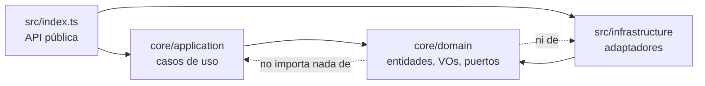

# ADR-0002 · Arquitectura hexagonal y estructura de carpetas de 05/06

- **Estado:** Aceptado
- **Fecha:** 2026-11-20
- **Relacionados:** [Arquitectura interna](../../05-estandares/arquitectura-interna.md), ADR-0009

## Contexto

`05-api/nest-agentic-api` y `06-agentic-factory` comparten una forma de trabajar: núcleo de dominio
aislado en una librería, value objects con validación, puertos de salida, un caso de uso por
archivo y adaptadores intercambiables. El dueño del repo pidió explícitamente que los proyectos
nuevos sigan exactamente esas prácticas y esa estructura.

Este proyecto es distinto en un punto: **es una librería que se publica en npm, no un servidor
Nest.** No hay controladores HTTP ni contenedor de inyección de Nest.

## Decisión

Se replica la estructura de 06, traduciendo solo lo que depende de Nest:

| En 05/06 | En 07 | Cambio |
| --- | --- | --- |
| `libs/<ctx>/src/core/domain/**` | `libs/<ctx>/src/core/domain/**` | Igual |
| `libs/<ctx>/src/core/application/{use-cases,services}` | igual | Igual |
| `libs/<ctx>/src/<ctx>.tokens.ts` | igual | Igual (símbolos de los puertos) |
| `libs/<ctx>/src/<ctx>-core.module.ts` (`register`/`registerAsync`) | `libs/<ctx>/src/<ctx>-core.ts` (`createCore(options)`) | Función de composición en lugar de `DynamicModule`; recibe los mismos `options` con los adaptadores |
| `src/modules/bounded/<ctx>/infrastructure/**` | `src/infrastructure/**` | Igual en contenido: adaptadores que implementan puertos |
| `src/modules/bounded/<ctx>/controllers/**` | `src/index.ts` (+ `src/cli/` si hay CLI) | La "entrada" es la API pública del paquete, no HTTP |
| `src/global/*.config.ts` | `src/config/*.config.ts` | Resolución de opciones con valores por defecto |
| `tests/` junto al código | igual | Igual |
| imports con `.js` + `moduleNameMapper` | igual | Igual (necesario para ESM) |
| alias `lib/<ctx>` en `tsconfig` | igual | Igual; tsup los resuelve al empaquetar |

Reglas de dependencia (se verifican con lint, ver [arquitectura interna](../../05-estandares/arquitectura-interna.md)):

## Alternativas consideradas

| Opción | Por qué no |
| --- | --- |
| Estructura plana (`src/*.ts`) típica de paquetes pequeños | Rompe la regla del repo y mezcla dominio con E/S |
| Monorepo con varios paquetes (`packages/core`, `packages/adapter-x`) | Más ceremonia de publicación; se reconsidera si aparecen adaptadores que deban instalarse aparte |
| Usar Nest como contenedor de DI | Arrastra dependencias pesadas a quien instale el paquete; contradice ADR-0010 |

## Consecuencias

- Quien conozca 05 o 06 se mueve por 07 sin aprender nada nuevo.
- Hay más archivos que en un paquete típico; se acepta a cambio de claridad y pruebas aisladas.
- Señal de revisión: si la librería resulta ser muy pequeña (menos de ~5 casos de uso), evaluar un
  ADR que simplifique capas sin romper las reglas de dependencia.
