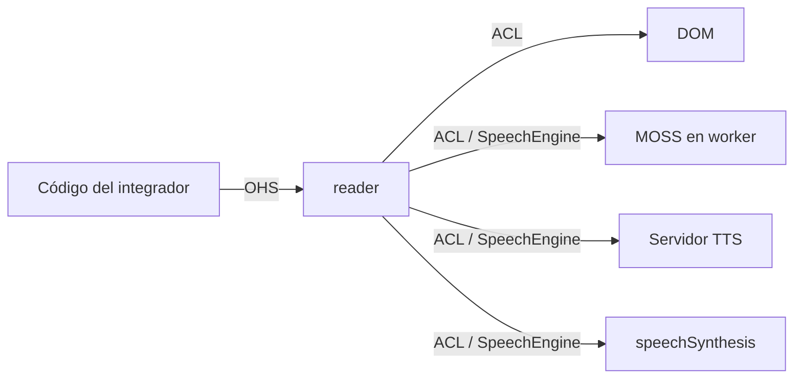

# Mapa de bounded contexts

- **Estado:** En revisión · **Fecha:** 2026-11-20

## Contextos

Se empieza con **un solo bounded context, `reader`** (`libs/reader/`), igual que 06 empezó con
`factory`. Detección y narración comparten el mismo lenguaje (artículo, bloque, segmento) y se
usan siempre juntas.

| Contexto | Responsabilidad | Carpeta |
| --- | --- | --- |
| `reader` | Detectar el artículo, prepararlo para la voz y gobernar la narración | `libs/reader/src` |

**Candidato a separarse más adelante:** la *inferencia de MOSS* (tokenizador, bucle de
decodificación, códec) tiene su propio lenguaje (tokens, codebooks, prefill, KV-cache) que no
comparte nada con el dominio del lector. Por eso no vive en `libs/reader`: vive en `src/worker/`
como detalle del adaptador `MossBrowserEngine`. Si se reutilizara fuera de este paquete, se
propondría un ADR para extraerlo como contexto o paquete propio.

## Relaciones con sistemas externos

| Externo | Relación DDD | Cómo se protege el dominio |
| --- | --- | --- |
| Código del integrador | Open Host Service: el elemento y su API son el lenguaje publicado | VOs en la frontera, errores del catálogo |
| DOM de la página | Anticorruption Layer (`DomArticleSource`) | El dominio recibe `ContentBlock` con referencias opacas, nunca nodos |
| MOSS-TTS-Nano (pesos y grafos) | Conformist (adoptamos su formato) detrás de un ACL (`MossBrowserEngine`) | El dominio solo ve `SpeechEngine` y `AudioChunk` |
| Servidor TTS del integrador | Conformist con el contrato OpenAI `/v1/audio/speech`, detrás de `MossServerEngine` | Igual |
| `speechSynthesis` | ACL (`WebSpeechEngine`) | Igual; el adaptador traduce sus eventos de palabra a progreso |

