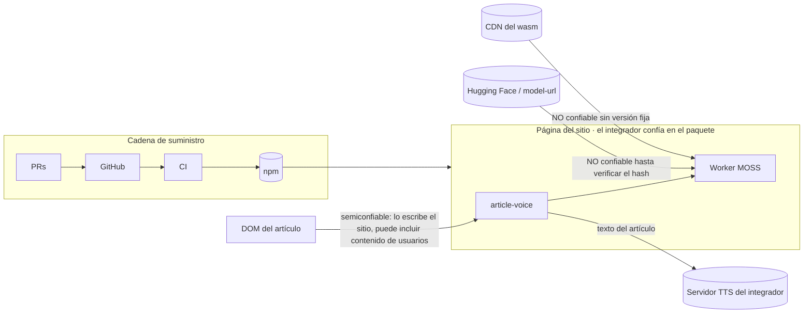

# Modelo de amenazas (STRIDE) y requisitos de seguridad

- **Estado:** En revisión · **Fecha:** 2026-11-20

## Activos

| Activo | Por qué importa |
| --- | --- |
| El paquete publicado (npm y CDN) | Se ejecuta en la página de cada sitio que lo usa, con acceso a su DOM |
| Cuenta de npm y Trusted Publishing | Quien la controle publica código en todos esos sitios |
| Recursos del modelo que se ejecutan en el navegador | Un grafo o un peso alterado se ejecuta en el dispositivo del visitante |
| Texto del artículo | Puede ser contenido de pago o privado (intranets, newsletters) |
| Dispositivo del visitante | Datos móviles, batería, memoria |

## Fronteras de confianza

## Amenazas de la cadena de suministro

| # | STRIDE | Amenaza | Mitigación | Requisito |
| --- | --- | --- | --- | --- |
| T-01 | S | Publicación suplantada | Trusted Publishing (OIDC) + provenance; 2FA; sin tokens | RNF-SEC-02, ADR-0007 |
| T-02 | T | Dependencia comprometida | Una sola dependencia de runtime con versión exacta; lockfile congelado; Dependabot | RNF-SEC-01, ADR-0015 |
| T-03 | T | Acción de GitHub comprometida | Acciones fijadas por SHA; permisos mínimos | [CI/CD](../07-operacion/ci-cd.md) |
| T-04 | T | PR malicioso | Revisión obligatoria; `files` explícito; prueba del contenido del tarball | ADR-0009 |
| T-05 | R | Origen de una versión dudoso | Provenance | RNF-SEC-02 |
| T-06 | I | Archivos internos en el tarball | `files` explícito; prueba que lista el tarball | RNF-PERF-02 |
| T-07 | D | Typosquatting | Reservar variantes del nombre | ADR-0011 |
| T-08 | E | Script de instalación | Sin scripts de ciclo de vida publicados | ADR-0010 |

## Amenazas del producto

| # | STRIDE | Componente | Amenaza | Mitigación | Requisito |
| --- | --- | --- | --- | --- | --- |
| T-10 | T | Descarga de pesos | Un proxy, un CDN o un cambio en el repo de origen altera los pesos o grafos | URL fijada a commit; SHA-256 por archivo del manifiesto incluido en el paquete; rechazo sin caché | RN-14, RNF-SEC-04 |
| T-11 | T | Caché de pesos | Otro script del mismo origen escribe en la caché | Se re-verifica el hash al leer de caché la primera vez en cada sesión | SEC-06 |
| T-12 | T | wasm de ORT desde CDN | jsDelivr sirve un wasm distinto | Versión exacta en la URL; opción `ort-wasm-url` para alojarlo uno mismo; documentado | ADR-0015 |
| T-13 | E | UI del componente | Texto del artículo (que puede incluir contenido de usuarios) se inserta como HTML → XSS | Nunca `innerHTML` con datos; solo `textContent`; el resaltado usa la Highlight API sin tocar el DOM | RNF-SEC-05 |
| T-14 | I | Motor `moss-server` | El texto del artículo viaja a un servidor | Solo al `server-url` que configura el integrador; HTTPS obligatorio; documentado en el README | RNF-PRIV-01 |
| T-15 | I | Motores locales | El paquete envía texto o uso a terceros | Sin telemetría; prueba de intercepción de red | RNF-PRIV-01/02 |
| T-16 | D | Dispositivo del visitante | Descarga enorme o consumo de memoria/batería sin consentimiento | Descarga solo tras play y confirmación con tamaño; adelanto limitado; liberar sesiones al detener tras 5 min | RN-06, RN-07, RN-15 |
| T-17 | D | Normalizador y segmentador | Una entrada patológica dispara una regex con backtracking catastrófico | Lint `regexp/no-super-linear-backtracking`; prueba con entradas de 200 000 caracteres | RN-12, SEC-03 |
| T-18 | S | Servidor TTS | `server-url` manipulado por el contenido de la página | La configuración solo viene de atributos/propiedades del integrador, nunca del artículo | SEC-07 |
| T-19 | T | Mensajes del worker | Otro script envía mensajes al worker | El worker es dedicado (no compartido); solo su creador tiene el puerto | — |

## Requisitos de seguridad

- SEC-01 · Toda opción pasa por un VO con límites explícitos.
- SEC-02 · Las preferencias leídas de `localStorage` se validan como entrada no confiable.
- SEC-03 · Ninguna regex con backtracking superlineal.
- SEC-04 · Los errores no incluyen el texto del artículo, solo su forma (longitud, índice).
- SEC-05 · Divulgación responsable en [SECURITY.md](../../SECURITY.md).
- SEC-06 · Hash verificado al descargar y la primera vez que se lee de caché en cada sesión.
- SEC-07 · `server-url`, `model-url` y `ort-wasm-url` deben ser `https:` (o `http://localhost`).
