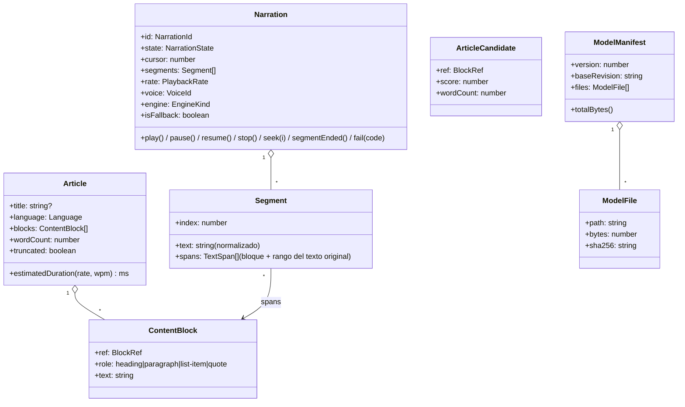

# Modelo de datos

- **Estado:** En revisión · **Fecha:** 2026-11-20

Sin base de datos. El modelo son las entidades y VOs del dominio y tres formatos que se guardan en
el navegador del visitante.

## Modelo del dominio

## Diccionario de datos

| Entidad / VO | Campo | Tipo | Validación | Descripción |
| --- | --- | --- | --- | --- |
| `Language` | valor | BCP 47 base (`es`, `en`…) | Uno de los 20 de MOSS; RN-10 | Idioma del artículo |
| `PlaybackRate` | valor | number | 0.75–2.0, paso 0.25 (RN-08) | Velocidad |
| `EngineKind` | valor | `auto`\|`moss-browser`\|`moss-server`\|`web-speech` | enumerado | Motor pedido o elegido |
| `VoiceId` | valor | string | `[a-z0-9-]{1,64}` | Voz del motor |
| `HttpsUrl` | valor | string | `https:` (o `http://localhost` en desarrollo) | `server-url`, `model-url`, `ort-wasm-url` |
| `MinWords` | valor | int | 1–10 000 | RN-01 |
| `Segment.text` | — | string | 1–300 caracteres (RN-05) | Texto normalizado |
| `TextSpan` | `block`, `start`, `end` | `BlockRef`, int, int | `0 ≤ start < end ≤ len(block.text)` | Para resaltar el texto original |
| `NarrationState` | — | ver diagrama de estados | transiciones válidas | — |
| `ModelFile.sha256` | — | hex de 64 caracteres | — | RN-14 |

`BlockRef` es opaco para el dominio: el adaptador del DOM lo usa para volver al nodo
(un `WeakRef` en un mapa propio), así que el dominio no retiene nodos.

## Formatos guardados en el navegador

| Qué | Dónde | Clave | Contenido | Versionado |
| --- | --- | --- | --- | --- |
| Recursos del modelo | Cache Storage | `article-voice-models-v{manifest.version}` | Respuestas HTTP de cada archivo del manifiesto | La versión del manifiesto está en el nombre de la caché; al cambiarla, se borra la caché anterior |
| Preferencias | `localStorage` | `article-voice:prefs` | `{ "v": 1, "rate": 1.25, "voice": "…" }` | Campo `v`; migración al leer; si falla la lectura, valores por defecto |
| Posición (Could, F-15) | `localStorage` | `article-voice:pos:<hash de la URL>` | `{ "v": 1, "cursor": 12, "at": "ISO" }` | Igual; caduca a los 30 días |

Todo acceso a `localStorage` va en `try/catch` (navegación privada, almacenamiento bloqueado).
