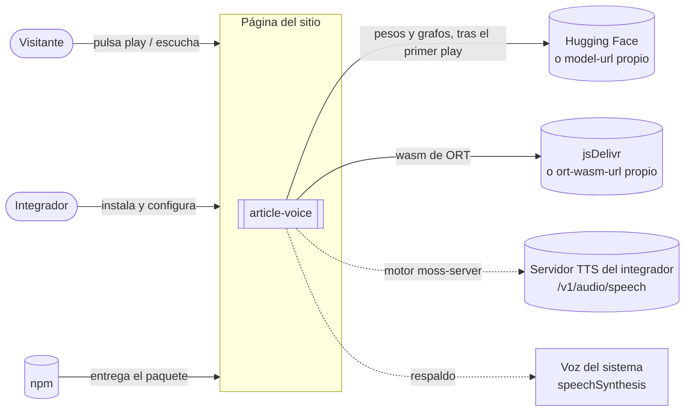
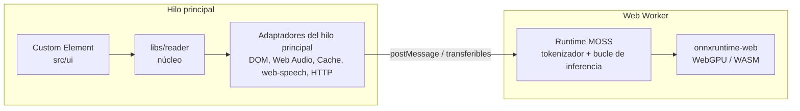
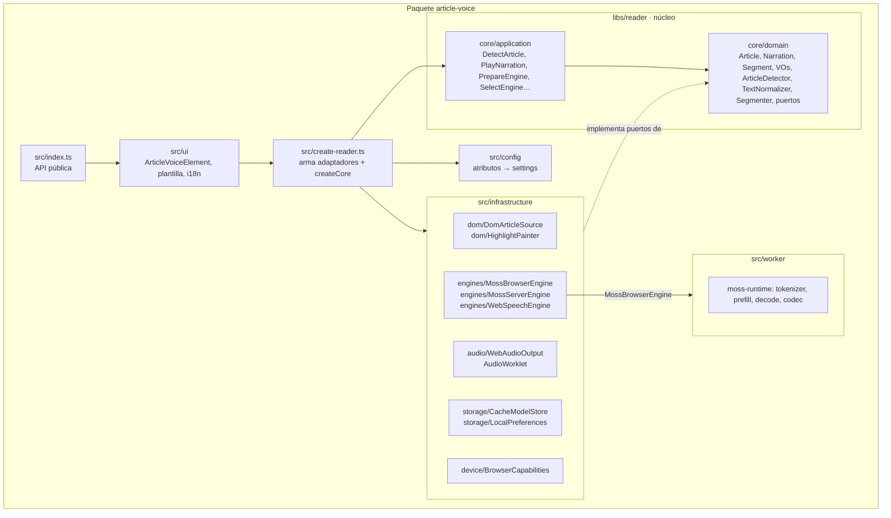

# Documento de arquitectura (SAD) · arc42 + C4 · `article-voice`

- **Estado:** En revisión · **Fecha:** 2026-11-20

## 1. Introducción y metas

- **Requisitos clave:** detectar el artículo (RF-02), narrarlo sin cortes (RF-09) con MOSS en el
  navegador (RF-10) sin descargar nada antes del play (RF-11), con respaldo (RF-16).
- **Metas de calidad**, en orden:
  1. **Fluidez de la voz** (RNF-PERF-10/11): si se corta, el producto no sirve.
  2. **Respeto al visitante** (RNF-NET-01, RNF-PRIV-01): sin descargas ocultas, el texto no sale del navegador.
  3. **Integración trivial en cualquier framework** (RNF-COMP-02, RNF-USA-02).
  4. **Contrato estable y cadena de suministro segura** (ADR-0007, ADR-0009).
  5. **Mantenibilidad** (ADR-0002).
- **Partes interesadas:** mantenedor, integradores, visitantes, contribuidores, OpenMOSS (autores del modelo).

## 2. Restricciones

SRS §2.4 (R-01…R-05) y [ADRs](adr/README.md).

## 3. Contexto (C4 nivel 1)

## 4. Estrategia de solución

| Meta | Enfoque |
| --- | --- |
| Fluidez | Inferencia en un Web Worker (WebGPU → WASM); síntesis por segmentos con adelanto; salida por AudioWorklet con cola sin huecos |
| Respeto al visitante | Descarga solo tras play, con tamaño y progreso; caché con verificación de hash; motor local por defecto |
| Integración trivial | Custom Element con Shadow DOM; atributos, propiedades, eventos; bundle de CDN |
| Contrato y cadena de suministro | Una dependencia diferida; API Extractor; provenance |
| Mantenibilidad | Hexagonal: el dominio no conoce DOM, Worker ni ORT; todo eso son adaptadores |

## 5. Vista de bloques (C4 niveles 2 y 3)

### Contenedores (dentro del navegador)

### Componentes

## 6. Vista de ejecución

Diagramas de secuencia en [diagramas](../04-diseno/diagramas.md): primer play con descarga,
reproducción con adelanto, y selección de motor.

## 7. Vista de despliegue

- **npm:** `dist/index.js` (elemento + API), `dist/auto.js`, `dist/worker.js`, `dist/cdn/*.js`, tipos, `NOTICE`.
- **En tiempo de ejecución:** todo en el navegador del visitante. Los pesos llegan de Hugging Face
  (o de `model-url`) y el `.wasm` de ORT de jsDelivr (o de `ort-wasm-url`). Opcionalmente, un
  servidor TTS operado por el integrador.

## 8. Conceptos transversales

- **Cancelación:** toda operación larga recibe un `AbortSignal` (detener, saltar, cancelar descarga).
- **Mensajería con el worker:** protocolo tipado `{ id, type, payload }`; el audio viaja como
  `Float32Array` transferible (sin copias).
- **Errores:** [catálogo](../04-diseno/catalogo-de-errores.md); el worker serializa `{ code, details }` y el hilo principal los reconstruye.
- **Validación:** atributos y opciones pasan por VOs (`PlaybackRate`, `Language`, `EngineKind`, `HttpsUrl`…).
- **Tiempo, azar e identificadores:** puertos `Clock` y `Random` (muestreo con semilla en pruebas).
- **i18n de la UI:** diccionarios es/en dentro del paquete, elegidos por el idioma del artículo.
- **Observabilidad:** eventos del contrato + `Logger` opcional ([observabilidad](../07-operacion/observabilidad.md)).

## 9. Decisiones

[Registro de ADRs](adr/README.md); en especial 0012 a 0018.

## 10. Escenarios de calidad

| ID | Estímulo | Respuesta esperada | Medida |
| --- | --- | --- | --- |
| QS-01 | El visitante pulsa play con el modelo en caché | Primer audio | ≤ 2 s p95 (Ref-D, WebGPU) |
| QS-02 | Artículo de 10 minutos | Reproducción continua | 0 vacíos de búfer |
| QS-03 | Página cargada sin interacción | Ninguna descarga del modelo | 0 bytes |
| QS-04 | Dispositivo sin WebGPU ni WASM con hilos | Voz del sistema con etiqueta | 100 % |
| QS-05 | Un proxy altera un archivo de pesos | Se rechaza y se informa | `AV_MODEL_INTEGRITY` |
| QS-06 | El integrador cambia el acento de color | El componente lo refleja | sin tocar el Shadow DOM |
| QS-07 | Un contribuidor cambia un tipo exportado sin querer | CI falla | 100 % |

## 11. Riesgos y deuda técnica

| Riesgo | Mitigación |
| --- | --- |
| MOSS no alcanza la velocidad necesaria en navegador (R-1) | Spike T-000 primero; ADR-0014 prevé cambiar `auto` |
| Port del runtime con errores sutiles de muestreo | Pruebas de equivalencia contra el runtime Python con semilla fija (mismos tokens) |
| Tokenizador SentencePiece propio | Pruebas de equivalencia con `sentencepiece` de Python sobre un corpus es/en |
| WebGPU inestable en algunos navegadores | Caída automática a WASM si falla la creación de la sesión |
| Detección frágil | Corpus de 30+ páginas reales anonimizadas en las pruebas |

## 12. Glosario

[Glosario](../01-producto/glosario.md).
