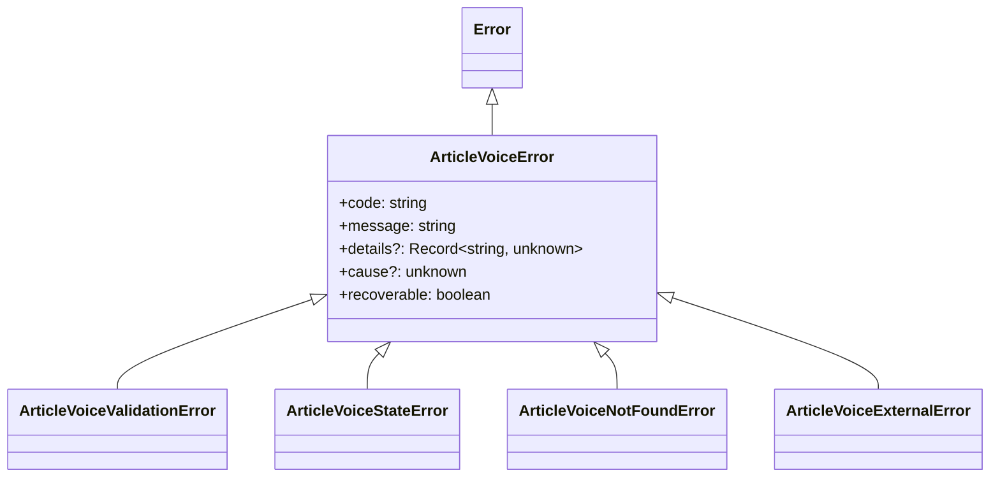

# Catálogo de errores

- **Estado:** En revisión · **Fecha:** 2026-11-20

Cada error que puede llegar al integrador está aquí. El **`code` es contrato público** y nunca cambia.
Los errores llegan por dos vías: el evento `article-voice:error` y el rechazo de `play()`.

## Jerarquía (pública)

Equivalencia con 05/06: `DomainValidationError` → `…ValidationError`, `InvalidStateTransitionError`
→ `…StateError`, `ResourceNotFoundError` → `…NotFoundError`. Los errores internos del dominio se
traducen a esta jerarquía en `src/` antes de salir.

## Reglas

- `code`: `AV_` + SCREAMING_SNAKE_CASE, estable para siempre.
- `message`: en inglés, dice qué pasó y qué hacer.
- `details`: datos para depurar (nombre del atributo, estado HTTP, bytes). **Nunca el texto del artículo** (SEC-04).
- `recoverable`: si un nuevo `play()` puede funcionar.
- Lo que ve el visitante no es el `message`, sino un texto corto traducido (es/en) en la UI.

## Catálogo

| Código | Clase | Cuándo | Recuperable | Texto en la UI (es) | Qué debe hacer el integrador |
| --- | --- | --- | --- | --- | --- |
| `AV_INVALID_OPTION` | Validation | Atributo o propiedad inválido; se usa el valor por defecto | sí | — (no se muestra) | Corregir el valor (`details.name`, `details.reason`) |
| `AV_ARTICLE_NOT_FOUND` | NotFound | `for`/`target` no encuentra el elemento (RN-04) | sí, tras `refresh()` | — (botón oculto) | Revisar el id o selector; llamar a `refresh()` si el contenido llega después |
| `AV_ARTICLE_TOO_SHORT` | Validation | Menos de `min-words` palabras (RN-01) | no | — (botón oculto) | Nada, o bajar `min-words` |
| `AV_INPUT_TOO_LARGE` | Validation | Más de 200 000 caracteres (RN-12); aviso | — | "Se leerá solo el principio del artículo" | Nada |
| `AV_UNSUPPORTED_LANGUAGE` | Validation | El idioma no lo soporta ningún motor disponible (RN-10) | no | — (botón oculto) | Revisar `lang` |
| `AV_ENGINE_UNAVAILABLE` | State | Ningún motor disponible con la configuración actual (RN-13) | no | — (botón oculto) | Permitir `fallback` o configurar `server-url` |
| `AV_DOWNLOAD_DECLINED` | State | El visitante no confirmó la descarga | sí | — | Nada |
| `AV_MODEL_DOWNLOAD_FAILED` | External | Fallo de red o HTTP al descargar recursos | sí | "No se pudo descargar la voz. Reintentar" | Revisar `model-url` y CORS si es propio |
| `AV_MODEL_INTEGRITY` | External | SHA-256 distinto del manifiesto (RN-14) | no | "La voz descargada no es válida" | Revisar `model-url`; nunca desactivar la verificación |
| `AV_STORAGE_QUOTA` | External | Sin espacio para la caché; continúa sin caché | — | — | Nada |
| `AV_ENGINE_INIT_FAILED` | External | ORT no pudo crear las sesiones (WebGPU y WASM fallaron) | no | "Este dispositivo no puede generar la voz" | Ver `details.backend` y `cause` |
| `AV_SERVER_ERROR` | External | El servidor TTS respondió con error o no responde | sí | "El servidor de voz no responde" | Revisar el servidor (`details.status`) |
| `AV_SYNTHESIS_FAILED` | External | El motor falló al sintetizar un segmento | sí | "Algo falló al generar la voz. Reintentar" | Reportar con `details.engine` |
| `AV_AUDIO_BLOCKED` | State | El navegador bloqueó el audio (sin gesto del usuario) | sí | "Pulsa play para escuchar" | No llamar a `play()` fuera de un gesto del usuario |
| `AV_ABORTED` | State | Operación cancelada (detener, saltar, cancelar descarga) | sí | — | Nada |
