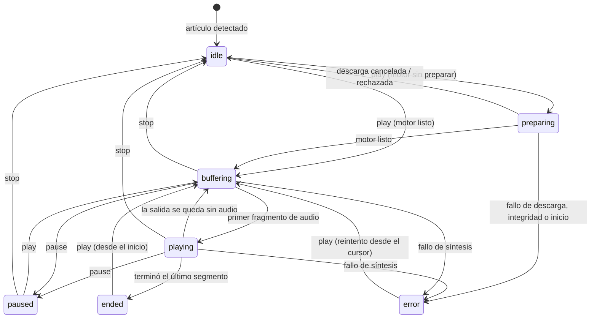
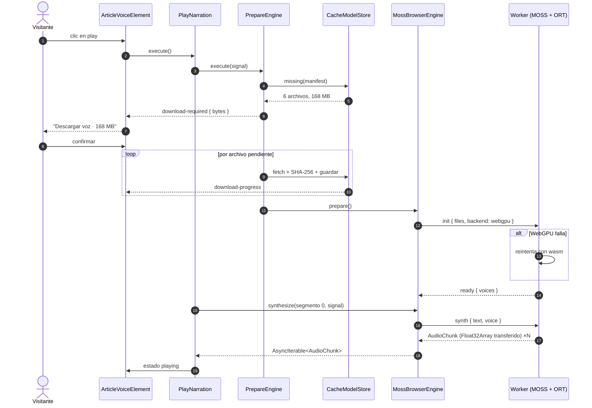
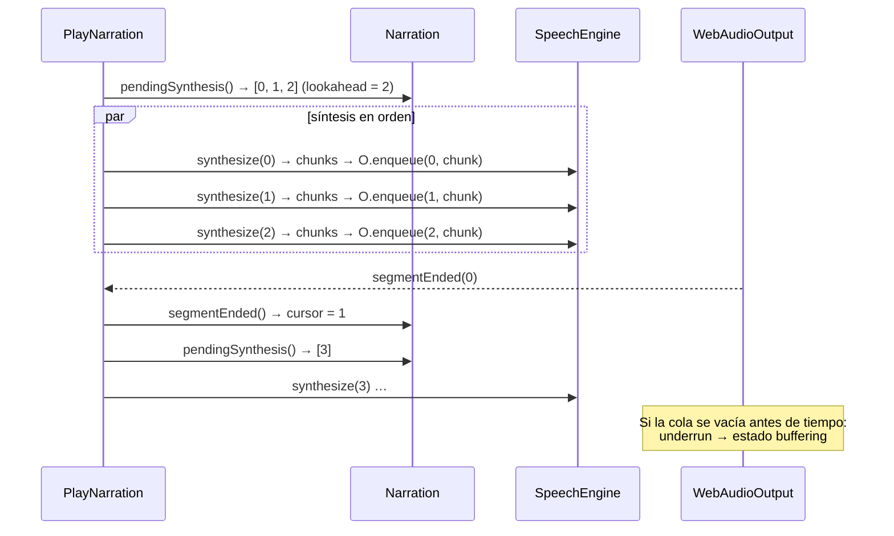
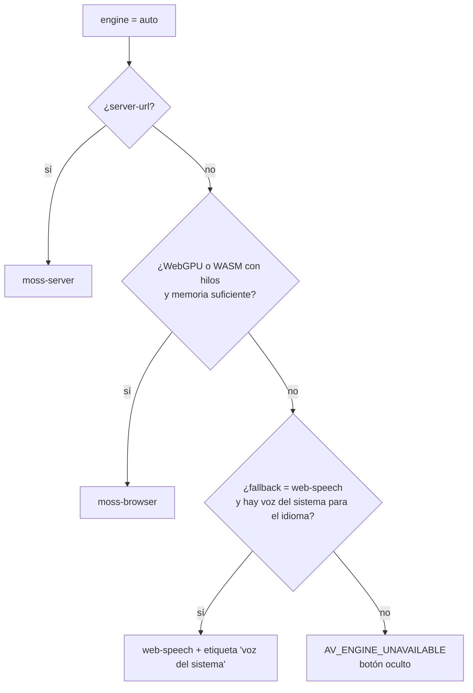

# Diagramas de secuencia y de estados

- **Estado:** En revisión · **Fecha:** 2026-11-20

## Estados de la narración

Cualquier otra transición es un error de programación (`InvalidNarrationTransition`), que en
producción se ignora y se registra con `Logger.warn`.

## Primer play con descarga (motor `moss-browser`)

## Reproducción con adelanto

La síntesis es **secuencial** en el worker (un modelo, una cola), pero va por delante de la
reproducción; el paralelismo está entre síntesis y reproducción, no entre segmentos.

## Selección del motor (`engine="auto"`)

