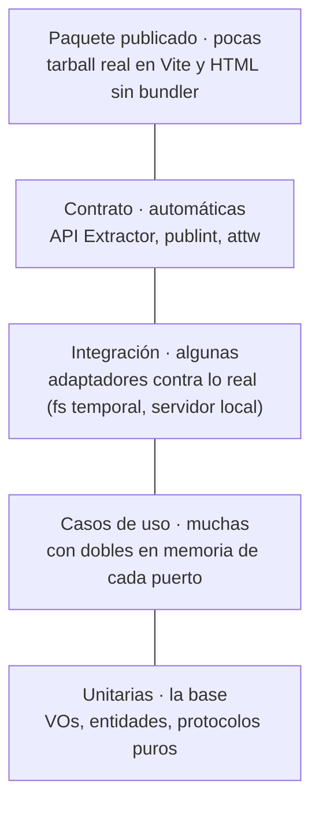

# Estrategia de pruebas

- **Estado:** Aprobado · **Base:** [ADR-0004](../03-arquitectura/adr/0004-pruebas-con-jest.md)

## Pirámide

| Nivel | Qué se prueba | Dónde | Dobles | Velocidad |
| --- | --- | --- | --- | --- |
| Unitario | VOs (validación y reglas), entidades (transiciones), funciones puras | `core/domain/**/tests/` | Ninguno | ms |
| Caso de uso | Flujos completos del núcleo a través de `createCore` | `core/application/**/tests/` | Dobles en memoria **de los puertos** (como `factory-loop.spec.ts` de 06) | ms |
| Integración | Cada adaptador contra la tecnología real, aislado | `src/infrastructure/**/tests/` | Recursos temporales reales (carpeta tmp, servidor local) | s |
| Contrato | Lo exportado no cambió sin querer; el paquete es consumible | CI | — | s |
| Paquete | `pnpm pack` → instalar el `.tgz` en un proyecto temporal → abrirlo en Playwright con Vite y con HTML sin bundler y ejecutar el ejemplo del README | `test/package/` | Ninguno | s |

**Contract tests de puertos:** cada puerto tiene una suite compartida
(`describe<Puerto>Contract(factory)`) que corren **tanto el doble en memoria como el adaptador
real**. Así el doble no miente: si el adaptador real se comporta distinto, la suite lo detecta.

## Cobertura mínima (falla CI si baja)

| Ámbito | Líneas | Ramas |
| --- | --- | --- |
| `libs/*/src/core/domain` | 95 % | 90 % |
| `libs/*/src/core/application` | 90 % | 85 % |
| `src/infrastructure` | 80 % | 70 % |
| Global | 90 % | 85 % |

La cobertura es una alarma, no un objetivo: una prueba sin aserciones relevantes no cuenta en revisión.

## Reglas

- Cada criterio de aceptación (Given/When/Then) tiene al menos una prueba con su ID en el nombre:
  `it('HU-03 · CA-2: rechaza …')`.
- Pruebas deterministas: el reloj, el azar y los identificadores entran por puertos (`Clock`,
  `IdGenerator`) y en pruebas se fijan.
- Sin red real en pruebas unitarias ni de casos de uso.
- Pruebas de propiedades (fast-check) para VOs con reglas de formato o rangos, cuando el dominio lo pida.
- Una prueba que falla de forma intermitente se arregla o se borra en el mismo día; no se reintenta.
